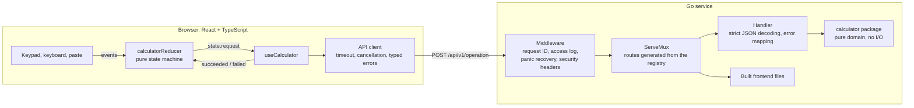

# Calculator: Go API + React

[](https://github.com/aozmekik/fullstack-calculator/actions/workflows/ci.yml)

A phone-style calculator whose every result comes from a small Go REST service.
The backend uses only the Go standard library. The frontend is React and
TypeScript, built around a pure state machine. Both are tested from unit level
to a real browser, and one Docker image serves them together.

<picture>
  <source media="(prefers-color-scheme: dark)" srcset="docs/images/calculator-dark.png">
  
</picture>

## Contents

- [Quick start](#quick-start)
- [Using the calculator](#using-the-calculator)
- [API](#api)
- [Architecture](#architecture)
- [Design decisions](#design-decisions)
- [Assumptions](#assumptions)
- [Testing and coverage](#testing-and-coverage)
- [What I would do next](#what-i-would-do-next)
- [AI usage](#ai-usage)

## Quick start

### With Docker

```bash
docker build -t fullstack-calculator .
docker run --rm -p 8080:8080 fullstack-calculator
```

Then open http://localhost:8080. The image holds one static Go binary that
serves both the API and the built frontend, running as an unprivileged user
on a distroless base.

### Locally

You need Go 1.27+, Node.js 22.22+ (see `.nvmrc`) and `make`. `make lint` also
needs [golangci-lint](https://golangci-lint.run/) v2.

```bash
make setup   # npm ci and the Playwright browser; Go needs no downloads
make dev     # API on :8080 and the app with hot reload on http://localhost:5173
```

In development, Vite proxies `/api` to the Go service, so the browser only ever
talks to one origin. To run the production build the way the Docker image does,
use `make run` and open http://localhost:8080.

| Command         | What it does                                                    |
| --------------- | --------------------------------------------------------------- |
| `make test`     | Backend tests (with the race detector) and frontend unit tests  |
| `make e2e`      | Playwright tests against the real server, desktop and mobile    |
| `make coverage` | HTML coverage reports for both apps                             |
| `make lint`     | golangci-lint, oxlint (type-aware), TypeScript and Prettier     |
| `make fuzz`     | Fuzzes the calculator's two properties, 30 seconds each         |
| `make`          | Lists every target                                              |

The server reads three environment variables:

- `PORT`, `8080` by default.
- `STATIC_DIR`, the built frontend to serve. It must contain an
  `index.html`, so a wrong path fails at startup.
- `LOG_FORMAT`, `json` (the default) or `text`.

## Using the calculator

- Click the keys or type. The keyboard shortcuts are listed under the keypad:
  `0`–`9`, `.`, `+ - * / ^ %`, `r` for √, `n` for ±, `Enter`, `Backspace` and
  `Esc`. You can also paste a number.
- Operations run left to right as you enter them, like a basic calculator:
  `2 + 3 × 4 =` is 20.
- `%` behaves like a phone calculator's. With `+` or `−` pending it takes a
  percentage of the left operand (`200 + 15% =` is 230); otherwise it divides
  by 100 (`200 × 15% =` is 30).
- A failed calculation keeps your input. After `5 ÷ 0`, the message appears
  under the display and the `5 ÷` is still pending, so you can type another
  divisor. After a network error, press the same key again to retry.
- Keys typed while an answer is on its way are queued and replayed once it
  arrives, so fast typing never drops a key. If the answer is an error, the
  queued keys are discarded, because they were typed assuming success.
- The history panel keeps the last 20 calculations. Select one to reuse its
  result.
- `Enter` means `=`. The exception is a button you moved to with `Tab`:
  then `Enter` presses that button, as everywhere else.

<p align="center"></p>

## API

Each operation has its own endpoint, `POST /api/v1/{operation}`, and takes its
operands as a JSON array. The full contract is in
[`docs/openapi.yaml`](docs/openapi.yaml) (OpenAPI 3.1).

| Endpoint                   | Body                 | Result                     |
| -------------------------- | -------------------- | -------------------------- |
| `POST /api/v1/add`         | `{"operands":[a,b]}` | a + b                      |
| `POST /api/v1/subtract`    | `{"operands":[a,b]}` | a − b                      |
| `POST /api/v1/multiply`    | `{"operands":[a,b]}` | a × b                      |
| `POST /api/v1/divide`      | `{"operands":[a,b]}` | a ÷ b                      |
| `POST /api/v1/power`       | `{"operands":[a,b]}` | a to the power b           |
| `POST /api/v1/sqrt`        | `{"operands":[x]}`   | √x                         |
| `POST /api/v1/percentage`  | `{"operands":[p,b]}` | p percent of b: p × b ÷ 100 |
| `GET /healthz`             | –                    | `{"status":"ok"}`          |

Requests must send `Content-Type: application/json`, which `curl --json` does
for you:

```console
$ curl --json '{"operands":[10,4]}' localhost:8080/api/v1/divide
{"operation":"divide","operands":[10,4],"result":2.5}

$ curl --json '{"operands":[16]}' localhost:8080/api/v1/sqrt
{"operation":"sqrt","operands":[16],"result":4}

$ curl --json '{"operands":[15,200]}' localhost:8080/api/v1/percentage
{"operation":"percentage","operands":[15,200],"result":30}

$ curl --json '{"operands":[0.1,0.2]}' localhost:8080/api/v1/add
{"operation":"add","operands":[0.1,0.2],"result":0.3}
```

### Errors

Every API error has the same shape, including unknown routes under `/api/`
and wrong methods. The `code` is stable and meant for programs; the `message`
is for people. Paths outside the API belong to the built frontend, and its
file server answers them with plain HTTP errors.

```console
$ curl -i --json '{"operands":[1,0]}' localhost:8080/api/v1/divide
HTTP/1.1 422 Unprocessable Entity
Content-Security-Policy: default-src 'self'; base-uri 'none'; form-action 'none'; frame-ancestors 'none'; object-src 'none'
Content-Type: application/json
Referrer-Policy: no-referrer
X-Content-Type-Options: nosniff
X-Request-Id: W4FH6MK4WOVYQUBZ2BZCAQCZ3T
Date: Tue, 27 Oct 2026 12:56:04 GMT
Content-Length: 67

{"error":{"code":"division_by_zero","message":"division by zero"}}

$ curl --json '{"operands":[1,null]}' localhost:8080/api/v1/add
{"error":{"code":"invalid_request","message":"operands[1] must be a number, not null"}}

$ curl --json '{"operands":[1,2],"extra":true}' localhost:8080/api/v1/add
{"error":{"code":"invalid_request","message":"unknown field \"extra\""}}
```

| Status | Code                     | When                                                                                                                                     |
| ------ | ------------------------ | ---------------------------------------------------------------------------------------------------------------------------------------- |
| 400    | `invalid_request`        | Malformed JSON, wrong types, unknown, duplicate or case-variant fields, trailing data, a `null` operand, the wrong number of operands, a number beyond float64 |
| 404    | `not_found`              | An unknown route, such as `/api/v1/modulo`                                                                                               |
| 405    | `method_not_allowed`     | Any method but `POST` on an operation (with `Allow: POST`)                                                                               |
| 413    | `payload_too_large`      | A body over 4 KiB                                                                                                                        |
| 415    | `unsupported_media_type` | A missing or non-JSON `Content-Type`                                                                                                     |
| 422    | `division_by_zero`       | `x ÷ 0`, or zero to a negative power                                                                                                     |
| 422    | `not_a_real_number`      | √ of a negative number, or a negative base with a fractional exponent                                                                    |
| 422    | `result_out_of_range`    | A result beyond ±1.8 × 10³⁰⁸, such as `10 ^ 400`                                                                                         |
| 500    | `internal_error`         | An unexpected failure; the details only go to the logs                                                                                   |

Every response carries an `X-Request-ID`. An incoming one is reused if it is
up to 64 characters of letters, digits, `.`, `_` or `-`; otherwise a random
one is generated. The same ID appears in the structured access log. It is for
correlating logs, not for security.

## Architecture



```
backend/
  cmd/server/            main: config from the environment, graceful shutdown
  internal/calculator/   the arithmetic: operation registry, sentinel errors, result rules
  internal/server/       HTTP: routes, strict decoding, error envelope, middleware, static files
frontend/
  src/api/               typed client for the API and its errors
  src/calculator/        reducer, input rules, formatting, keypad definition, hooks
  src/components/        Calculator, Display, Keypad, History
  e2e/                   Playwright specs, plus the screenshot generator
docs/                    OpenAPI spec and README images
```

Dependencies point inward on both sides. In Go, `server` depends on
`calculator`, which depends on nothing. In React, components use hooks, which
use the pure reducer and the API client. No layer reaches back up.

## Design decisions

**The Go service uses only the standard library.** Go 1.22's `ServeMux`
patterns, `log/slog` and `encoding/json/v2` (standard since Go 1.27) cover
everything a service this size needs. There is no framework to learn, no
dependency to audit, and no `go.sum`. json/v2 is the reason this is practical:
it matches field names case-sensitively, rejects duplicate names and trailing
data, and returns typed errors with a JSON pointer to the offending value. That
is how messages like `operands[1] must be a number` come about without
matching on error text.

**One endpoint per operation, generated from a registry.** The calculator keeps
its operations in a single map of arity and function. The router registers
`POST /api/v1/<name>` for each one, plus a method-less pattern on the same path
that answers other methods with a JSON 405 rather than the catch-all 404.
Adding an operation is one registry entry and its tests; the route, the 404
for unknown names and the error mapping follow. The frontend is mounted on a
method-less `/`, because `GET /` would conflict with those patterns and make
`ServeMux` panic at startup.

**Operands are an array.** `{"operands":[...]}` is the same shape for unary and
binary operations, and the domain validates the count. Operands decode into
`*float64` so that a JSON `null` is rejected instead of silently becoming 0.
Calculations are safe and idempotent, so `GET` would also have been
defensible. `POST` keeps one typed JSON body and one validation path.

**float64, rounded only where rounding removes noise.** √ and fractional
powers need floating point, so the API uses float64, and normalizes each
result:

- Fractions below 10¹⁵ are rounded to 15 significant digits, the most float64
  can carry through every decimal round trip. That removes binary noise:
  `0.1 + 0.2` is `0.3`.
- Everything else is returned as computed: every integer, and every value from
  10¹⁵ up. There, 15 significant digits would drop real digits (`2^50 + 0.5`
  would come out below `2^50`).
- `percentage` multiplies before dividing, which is exact whenever the product
  is: 7% of 10¹⁷ is exactly 7 × 10¹⁵.

Results are never NaN, Infinity or `-0`. Two fuzz tests check these rules:

- every result is finite and never `-0`;
- normalizing a result twice changes nothing;
- normalizing never reorders two values.

Money would be different: there I would use integer minor units or a decimal
type, never float64.

**400 versus 422.** A request the server cannot read (malformed, the wrong
shape, the wrong number of operands) is the client's mistake: 400. A
well-formed request whose math has no answer (division by zero, √−1, an
overflow) is 422. Every API error, including 404, 405, 413, 415 and panics,
uses the same JSON envelope with a stable `code`. The frontend chooses its own
wording from the code instead of showing server text.

**Strict on input.** The server rejects:

- bodies over 4 KiB;
- any `Content-Type` other than JSON (which also stops plain cross-site form
  posts);
- unknown, duplicate or case-variant fields;
- trailing data;
- `null` operands;
- numbers beyond float64.

An oversized body also closes the connection, so the server never reads the
rest of it. `http.Server` sets header, read, write and idle timeouts, and
`SIGTERM` lets in-flight requests finish before the process exits.

**One origin, no CORS.** In production the Go binary serves the built frontend
next to the API. In development the Vite proxy plays the same role. There is
no CORS configuration to get wrong, and the app runs under a strict
Content-Security-Policy (`default-src 'self'`). Fingerprinted assets are
cached forever, while `index.html` is revalidated on every load.

**The service is stateless.** History lives in the browser tab, so any number
of instances can run behind a load balancer.

**A pure state machine drives the frontend.** `calculatorReducer` never calls
the API. When it needs a calculation it puts a request in its state, and
`useCalculator` performs it and reports back with a `succeeded` or `failed`
event. Every calculator rule is therefore synchronous and deterministic, and
it is tested without a network or a DOM. Two behaviours follow from this
design:

- Keys pressed while a request is in flight are queued and replayed after it
  succeeds. If it fails they are dropped, because they were typed assuming
  success.
- A failed request leaves the state exactly as it was, plus an error.
  Everything typed before it is kept, and pressing the same key again sends
  the same request.

The API client is passed in as a prop. Component tests give it a fake, and
the client's own tests give it a fake `fetch`, so the tests need no
network-mocking library.

**All arithmetic happens on the server.** The browser only edits input: digits,
the decimal point, the sign and backspace. Every operation, including `%` and
`√`, is a request to the API. Chained operations run left to right as they are
entered, as on a basic calculator, rather than by operator precedence.

**Accessibility is tested, not assumed.** The keypad is made of real
`<button>`s, and one table defines both the on-screen keys and the keyboard
map, so the two cannot drift apart. Symbol keys get word names (`÷` is
"Divide"). Text keys keep their visible text as their name (WCAG 2.5.3), with
the meaning as a description: `AC` is described as "All clear". The display is
a live region, and errors use `role="alert"`. Mouse clicks do not move focus,
so `Enter` keeps meaning `=`, while `Enter` on a button reached with `Tab`
presses it. The end-to-end suite runs axe against WCAG 2.2 AA in both light
and dark themes.

**Tooling follows the current Vite template.** Vite 8 now scaffolds React
projects with oxlint and TypeScript 7's native compiler. typescript-eslint
does not support TypeScript 7 yet, so oxlint runs in type-aware mode instead.
It catches the same class of bugs, such as floating promises and unbound
methods. Tests use Vitest 5 with Testing Library, and Playwright for the
browser.

**A small, unprivileged image.** The multi-stage build compiles the frontend in
Node and a static (`CGO_ENABLED=0`) binary in Go. The final image is distroless
`static-debian13:nonroot`, about 10 MB, with no shell, no package manager and
no root user. CI builds the image and smoke-tests it with `curl`.

The end-to-end suite can also run against the image. Start the container on
port 8090, then run Playwright, which reuses a server that is already
listening there:

```bash
docker run --rm -p 8090:8080 fullstack-calculator
cd frontend && npx playwright test
```

## Assumptions

- Numbers are typed with at most 15 digits, which float64 represents exactly.
- `percentage` means "p percent of b". On the keypad, `%` follows phone
  calculators, as described above.
- A negative base needs an integer exponent: `(-8)^(1/3)` is
  `not_a_real_number` rather than a complex or principal-root answer. `0^0`
  is 1, as in most languages.
- Results smaller than the smallest float64 become 0 (`10 ^ -400`).
- The display formats numbers in en-US style (`1,234.5`), matching the `.` key.
  Values are shown in full below 2⁵³, where every integer is exact; from 10¹⁵
  up, fractions are rounded to the nearest integer. Larger magnitudes, and
  magnitudes below 10⁻⁶, use scientific notation.
- There is no authentication or persistence. History is per browser tab.

## Testing and coverage

| Suite                    | What it covers                                                                                                   | Size                     |
| ------------------------ | ---------------------------------------------------------------------------------------------------------------- | ------------------------ |
| Go unit and HTTP tests   | Every operation and edge case; the full HTTP contract, byte for byte; middleware; config; the real server started and stopped | 175 cases, race detector |
| Go fuzzing               | Results are finite, never `-0`, stable under normalization and never reordered by it; errors are always documented sentinels | `make fuzz`, 30 s in CI  |
| Frontend unit and component | Every state-machine rule, formatting, input validation, the API client, the UI through Testing Library       | 185 tests                |
| End-to-end               | The built app against the real Go server on desktop and mobile Chromium, including an axe scan in both themes    | 16 tests                 |

| Coverage                     | Statements | Branches | Functions | Lines |
| ---------------------------- | ---------- | -------- | --------- | ----- |
| `backend/internal/calculator` | 100%       |          |           |       |
| `backend/internal/server`     | 100%       |          |           |       |
| `backend` overall             | 96.4%      |          |           |       |
| `frontend/src`                | 100%       | 98.9%    | 100%      | 100%  |

Go reports statement coverage only. The uncovered backend lines are `main()`
itself and two branches that need the OS to fail a `listen` or a shutdown.

`make coverage` writes `backend/coverage.html` and `frontend/coverage/index.html`.
CI fails if either side drops below 90%. It also publishes both reports as
artifacts and adds a summary to each run.

Every push runs [CI](.github/workflows/ci.yml):

- **Backend:** golangci-lint, govulncheck, tests with the race detector, a
  coverage gate and a short fuzz run.
- **Frontend:** `npm audit` of runtime dependencies, oxlint, TypeScript,
  Prettier, tests with a coverage gate, and a production build.
- **End-to-end:** the Playwright suite, in the official Playwright container
  so browsers need no install.
- **Docker:** the image is built and smoke-tested with `curl`.
- **OpenAPI:** the spec is linted.

## What I would do next

- **Observability:** Prometheus metrics per operation and status, OpenTelemetry
  traces carrying the request ID, and a readiness probe separate from
  liveness.
- **Edge protection:** rate limiting per client in front of the service.
- **Contract testing from the spec:** for example, Schemathesis generating
  requests from `docs/openapi.yaml`, so the spec and the server cannot drift.
- **Exact decimal arithmetic** (`math/big`) as an opt-in for financial
  calculations, and expressions with operator precedence.
- **Releases:** publish signed images with an SBOM to a registry from CI.

## AI usage

This project was built with Claude Code. [PROMPTS.md](PROMPTS.md) lists the
prompts used, verbatim, and describes how the AI was used and what was
checked.
