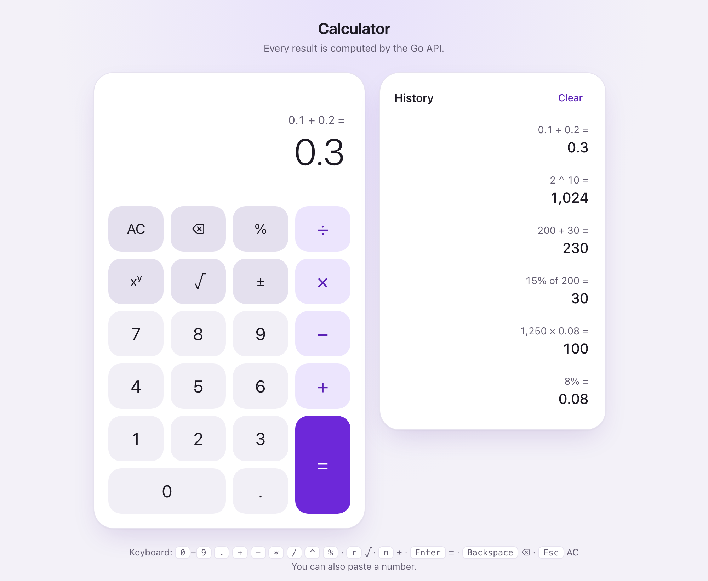
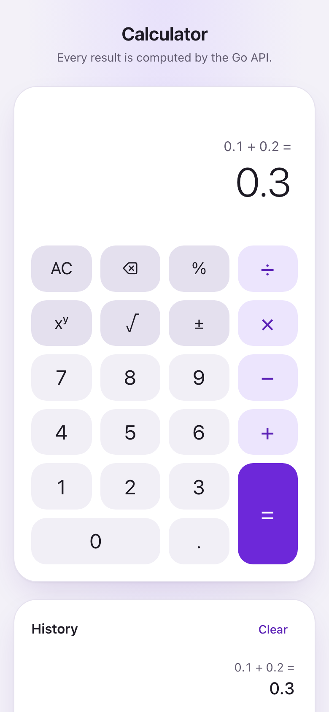

# Calculator: Go API + React

[](https://github.com/aozmekik/fullstack-calculator/actions/workflows/ci.yml)

A phone-style calculator. The React + TypeScript frontend sends every
operation to a small Go REST service, which uses only the standard library.

<p align="center">
  <picture>
    <source media="(prefers-color-scheme: dark)" srcset="docs/images/calculator-dark.png">
    
  </picture>
  
</p>

## Quick start

With Docker:

```bash
docker build -t fullstack-calculator .
docker run --rm -p 8080:8080 fullstack-calculator
```

Then open http://localhost:8080. A single Go binary serves both the API and
the built frontend.

Locally, you need Go 1.27+, Node.js 22.22.2+ and `make` (and
[golangci-lint](https://golangci-lint.run/) for `make lint`):

```bash
make setup   # frontend dependencies and the Playwright browsers
make dev     # API on :8080, app with hot reload on http://localhost:5173
```

Without `make`, run each side in its own terminal:

```bash
cd backend && go run ./cmd/server         # API on :8080
cd frontend && npm ci && npm run dev     # app on http://localhost:5173
```

In development, Vite proxies `/api` to the Go service. `make run` serves the
production build from the Go binary, the way the Docker image does, and `make`
lists every other target: `test`, `lint`, `coverage`, `e2e` and more.

## API

Each operation has its own endpoint and takes its operands as a JSON array.
The full contract is in [docs/openapi.yaml](docs/openapi.yaml) (OpenAPI 3.1).

| Endpoint                   | Operands | Result          |
| -------------------------- | -------- | --------------- |
| `POST /api/v1/add`         | `[a, b]` | a + b           |
| `POST /api/v1/subtract`    | `[a, b]` | a − b           |
| `POST /api/v1/multiply`    | `[a, b]` | a × b           |
| `POST /api/v1/divide`      | `[a, b]` | a ÷ b           |
| `POST /api/v1/power`       | `[a, b]` | a to the power b |
| `POST /api/v1/sqrt`        | `[x]`    | √x              |
| `POST /api/v1/percentage`  | `[p, b]` | p% of b         |
| `GET /healthz`             | –        | `{"status":"ok"}` |

`curl --json` sends the required `Content-Type: application/json`:

```console
$ curl --json '{"operands":[10,4]}' localhost:8080/api/v1/divide
{"operation":"divide","operands":[10,4],"result":2.5}

$ curl --json '{"operands":[0.1,0.2]}' localhost:8080/api/v1/add
{"operation":"add","operands":[0.1,0.2],"result":0.3}

$ curl --json '{"operands":[1,0]}' localhost:8080/api/v1/divide
{"error":{"code":"division_by_zero","message":"division by zero"}}

$ curl --json '{"operands":[1,null]}' localhost:8080/api/v1/add
{"error":{"code":"invalid_request","message":"operands[1] must be a number, not null"}}
```

Every API error has that shape, with a stable `code`:

| Status | Code                                                           | When                                                          |
| ------ | -------------------------------------------------------------- | ------------------------------------------------------------- |
| 400    | `invalid_request`                                              | Malformed JSON, wrong types or fields, the wrong number of operands |
| 404    | `not_found`                                                    | An unknown route, such as `/api/v1/modulo`                    |
| 405    | `method_not_allowed`                                           | Any method but `POST` on an operation                         |
| 413    | `payload_too_large`                                            | A body over 4 KiB                                             |
| 415    | `unsupported_media_type`                                       | A `Content-Type` other than JSON                              |
| 422    | `division_by_zero`, `not_a_real_number`, `result_out_of_range` | A valid request whose math has no answer                      |
| 500    | `internal_error`                                               | An unexpected failure; details go only to the logs            |

## Design decisions

The reasoning behind each decision is in [docs/DESIGN.md](docs/DESIGN.md).

- **Standard library only.** `net/http` routing, `log/slog` and
  `encoding/json/v2`, which is strict by default and points errors at the
  exact field. The Go module has no dependencies.
- **One endpoint per operation, generated from a single registry.** Adding an
  operation is one entry plus its tests.
- **400 versus 422.** A request the server cannot read is the client's mistake;
  a valid request with no mathematical answer, such as 1 ÷ 0, is unprocessable.
- **float64, rounded where it removes noise.** Fractions are rounded to 15
  significant digits, so 0.1 + 0.2 is 0.3; integers and very large values are
  returned as computed. Money would call for a decimal type instead.
- **A stateless, same-origin service.** The Go binary also serves the
  frontend, so there is no CORS to configure, and history lives in the browser.
- **A pure state machine for the UI.** The reducer never calls the API: it
  records the calculation it needs, and a hook runs it. Keys typed while a
  request is in flight are queued, and a failed request leaves the input as
  it was.
- **All arithmetic on the server.** The browser only edits input: digits,
  sign and backspace.
- **Accessible by design.** Real buttons, a live result region and full keyboard
  support, checked with axe in the end-to-end tests.
- **A small, unprivileged image.** A multi-stage build produces a ~10 MB
  distroless image that runs as a non-root user.

## Assumptions

- Operations run left to right as they are entered, like a basic calculator:
  `2 + 3 × 4 =` is 20.
- `%` works like a phone calculator's: `200 + 15% =` is 230, and
  `200 × 15% =` is 30.
- Numbers are typed with at most 15 digits. The display shows up to 14
  significant digits, one guard digit fewer, so `1 ÷ 3 × 3` reads 1.
- A negative base needs an integer exponent: `(-8)^(1/3)` is reported as not a
  real number. `0^0` is 1.
- There is no authentication or persistence.

## Tests and coverage

| Suite                                  | Run with    | Result                                                                                   |
| -------------------------------------- | ----------- | ---------------------------------------------------------------------------------------- |
| Backend unit and HTTP tests, with fuzzing | `make test`, `make fuzz` | 176 cases with the race detector; 100% coverage of the calculator and HTTP packages, 96.5% overall |
| Frontend unit and component tests      | `make test` | 191 tests; 100% of lines                                                                 |
| End-to-end, against the real server    | `make e2e`  | Chromium, WebKit, Pixel and iPhone; Firefox in CI; an axe accessibility scan            |

`make coverage` writes HTML reports to `backend/coverage.html` and
`frontend/coverage/index.html`. [CI](.github/workflows/ci.yml) runs all of
these on every push to `main`, together with linting, a vulnerability scan,
the Docker build and an OpenAPI lint. It fails if coverage drops below 90%.

## Project structure

```
backend/
  cmd/server/            entry point: configuration, graceful shutdown
  internal/calculator/   the arithmetic: operations, errors, rounding rules
  internal/server/       HTTP: routes, validation, errors, middleware
frontend/
  src/api/               typed API client
  src/calculator/        state machine, input rules, formatting
  src/components/        Calculator, Display, Keypad, History
  e2e/                   Playwright end-to-end tests
docs/                    design notes, OpenAPI spec, screenshots
```

## AI usage

Built with Claude Code. [PROMPTS.md](PROMPTS.md) describes how it was used and
summarizes the prompts.
